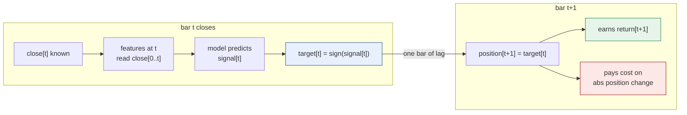
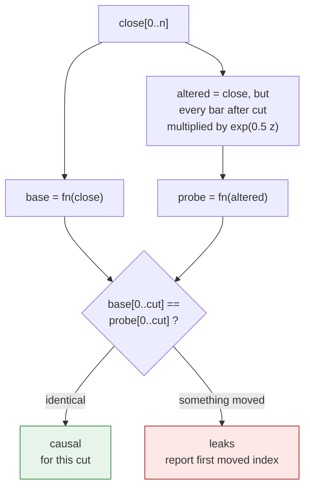
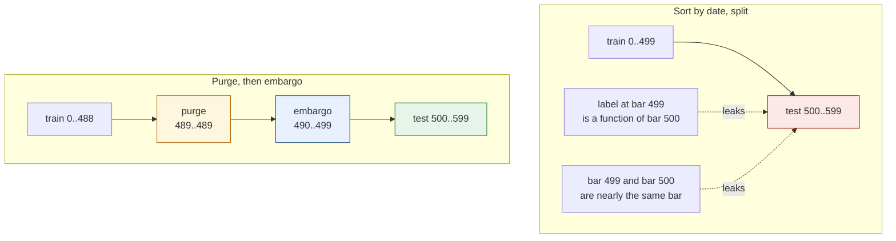
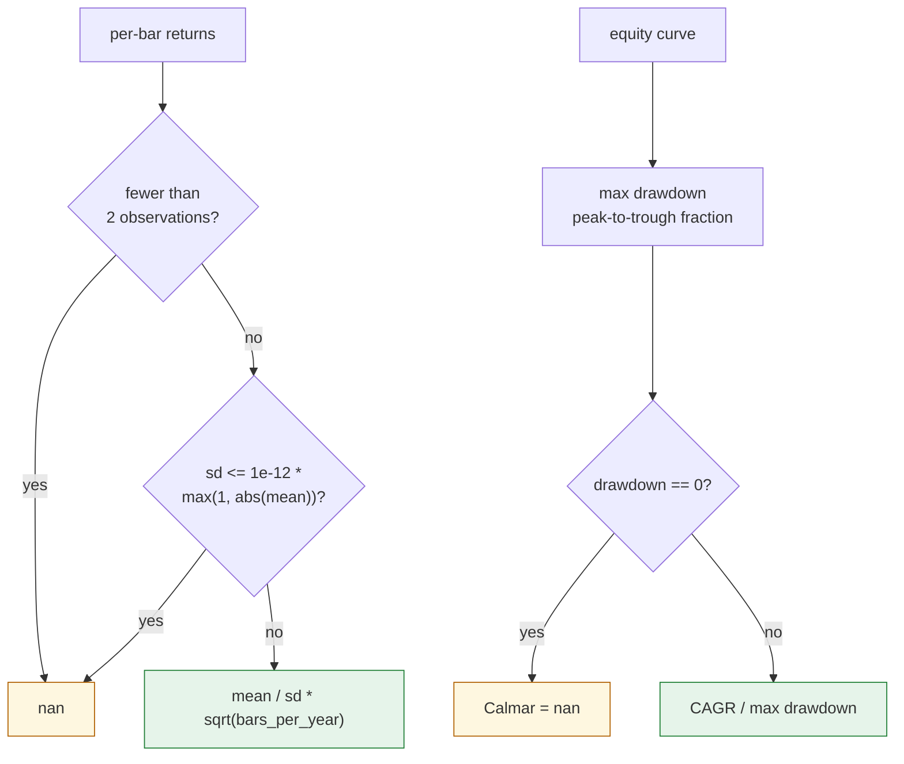

*English ｜ [繁體中文](design.zh-TW.md)*

# Design notes

Four decisions the README asserts, with the reasoning behind each.

---

## 1. The index convention, and the one shift that enforces it

Every alignment bug in a backtest is a disagreement about what index `t`
means. So it is fixed once, in one sentence, and the rest of the code obeys
it:

> A feature at index `t` may read `close[0..t]` inclusive. Bar `t` has
> closed, so its close is known. The position that reading produces is held
> over bar `t + 1`.

In code that is two lines in `backtest.run`:

```python
position = np.zeros(c.size)
position[1:] = target[:-1]
```



Two consequences are asserted directly:

- Bar 0 is always flat. There is no bar -1 to have decided anything.
- A signal equal to the current bar's own return — information genuinely
  available at the close — earns nothing once lagged. On a signal-free
  series the same numbers applied without the lag score
  `sum(abs(return))`, which is the whole series. That difference is what a
  lookahead bug is worth on paper.

Features return arrays the same length as the input, with `nan` during
warm-up, rather than shorter arrays. Dropping rows at the source shifts
every index downstream by a different amount per feature, and that shift is
invisible until the equity curve looks too good. `Design.rows` carries the
bar index of every retained row, so the translation back to bar space is one
lookup rather than arithmetic repeated at each call site.

---

## 2. Why the leak checker perturbs the future instead of reading the code

A code review catches `close[t+1]`. It does not reliably catch a
`StandardScaler` fitted before the split, or a centred rolling window, or a
back-filled `nan`. Those three contain no forward index at all; the
information arrives through a statistic computed over the wrong range.

So the checker treats the feature as a black box and tests the property that
actually matters:



Three details that are load-bearing:

**The perturbation is multiplicative through `exp`, not `1 + z`.** The first
version used `close * (1 + 0.5 * randn)`, which drove some bars negative.
Every log-return feature then returned `nan`, and the checker reported leaks
that were artefacts of being handed an impossible price series. A checker
that can be fooled by its own input is worse than no checker.

**The shock is large, not small.** A tiny edit can hide inside float
rounding, and the comparison uses `np.isclose` with a tight tolerance.
Half a standard deviation of log-price is far outside that.

**Several cut points, including an early one.** The checker originally split
at the midpoint and caught three leaks out of four. `backfilled_warmup`
passed clean, because it corrupts only the first sixty bars and by bar 750
there is nothing left to back-fill. `default_cuts()` now probes
`{20, n/10, n/4, n/2, 3n/4, n-5}`.

`nan`-ness is compared as well as value, because a feature that starts
producing numbers where it used to produce `nan` has also changed.

The reported `first_leak` index is the diagnostic, and the distinction it
draws matters when you are the one fixing it:

| first moved index | what it means |
|---|---|
| one bar behind the cut | a shift in the wrong direction |
| roughly a window behind the cut | a centred window; the distance is half the window |
| **0** | a statistic computed over the whole series |

---

## 3. Purge and embargo are two parameters because they are two leaks



They are kept as separate parameters because they are known to different
precision:

| | leaks through | length |
|---|---|---|
| purge | the label horizon — a label at `t` is a function of bars up to `t + h` | **exact**: `h` |
| embargo | serial correlation between adjacent bars | **a choice**: no exact value exists |

Collapsing them into one gap would be smaller code and would make
`embargo=0` silently stop purging the label horizon, which is a leak with no
symptom. `tests/test_split.py` asserts that case on its own.

The implementation detail worth stating: the gap is placed between the end
of training and the start of the test window, so `gap == horizon + embargo`
is directly measurable per fold. The tests assert the distance rather than
the stored parameter. A parameter that is recorded and never applied is
exactly the bug this guards against.

Folds walk forward and training is always strictly in the past, so the
embargo has one side here. `purged_window()` handles the single-holdout case
where training data exists on both sides, and there the embargo applies
after the test window while the purge applies before it.

---

## 4. Why degenerate metrics return `nan`



A strategy that holds nothing has a flat equity curve. Max drawdown is
genuinely `0`. Sharpe is undefined, and the three candidate answers are not
equally wrong:

| returned | problem |
|---|---|
| `0.0` | reads as a measured result. A reviewer sees a strategy with no risk-adjusted return rather than one with no returns. |
| an exception | a report containing one legitimately flat row cannot be produced at all |
| `nan` | propagates, prints as `nan`, forces whoever reads it to look |

The dispersion guard is where this got interesting. `sd == 0.0` was the
first version. A test asserting "a constant return series has no Sharpe
ratio" failed against it: 500 identical 1 bp returns give a sample standard
deviation around **1e-20**, because the computed mean does not come back
exactly equal to the input. The guard passed the value through and the ratio
came out near **1e16** annualised. A relative floor fixes it, and the
constant is named `ZERO_DISPERSION` with the story in the comment.

Annualisation is a parameter of every function that annualises, and the
`bars_per_year` used is carried in the report. `252` appears once, as a value
in `BARS_PER_YEAR`, never as a literal inside a formula. The same return
series annualised daily and weekly differ by `sqrt(252/52)`, about **2.2x**,
and that is asserted rather than described.

---

## Where the tests sit against this

| design element | test |
|---|---|
| position held one bar after the signal | `test_position_is_held_one_bar_after_the_signal` |
| a same-bar signal earns nothing | `test_a_same_bar_signal_earns_nothing_once_the_lag_is_applied` |
| every shipped feature survives perturbation | `test_every_shipped_feature_is_causal` |
| all four planted leaks are caught | `test_checker_catches_every_leak` |
| the leak distance identifies the bug | `test_leak_distance_is_reported_and_matches_the_bug` |
| gap equals purge plus embargo | `test_the_gap_is_exactly_purge_plus_embargo` |
| embargo 0 still purges | `test_zero_embargo_still_purges_the_label_horizon` |
| no bar predicted by a model that saw it | `test_no_bar_is_predicted_by_a_model_that_trained_on_it` |
| costs reach the equity curve | `test_zero_cost_and_real_cost_give_different_sharpe` |
| all-cash gives 0 drawdown and nan Sharpe | `test_all_cash_has_zero_drawdown_and_no_sharpe` |
| a constant return series has no Sharpe | `test_a_constant_non_zero_return_also_has_no_sharpe` |
| an inverted signal gives a negative Sharpe | `test_inverting_a_profitable_signal_inverts_the_sign_of_sharpe` |
| annualisation is a parameter | `test_annualisation_is_a_parameter_not_a_constant` |
| short and flat baselines refuse to answer | `test_a_short_window_reports_insufficient_data_not_ok`, `test_a_flat_baseline_reports_insufficient_data_not_an_infinite_z` |
| the planted regime change is found | `test_the_volatility_regime_change_is_detected_where_it_happens` |
| no signal planted, none found | `test_with_no_signal_planted_the_pipeline_finds_none` |
| one leaky feature breaks everything | `test_a_leaky_feature_set_scores_absurdly_well` |
| identical seeds, identical equity | `test_two_identical_walk_forward_runs_give_identical_equity` |
