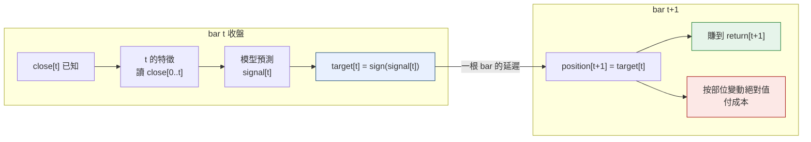
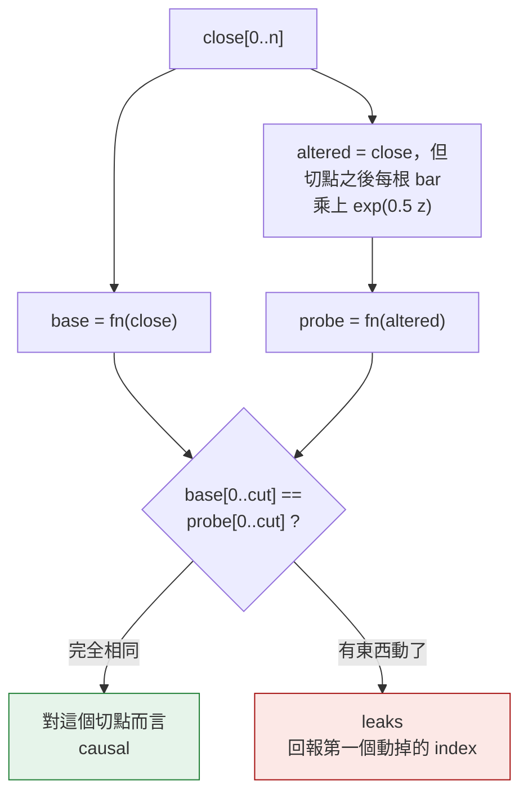
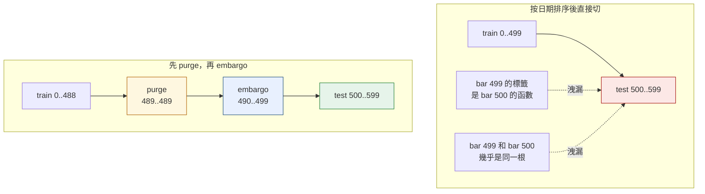
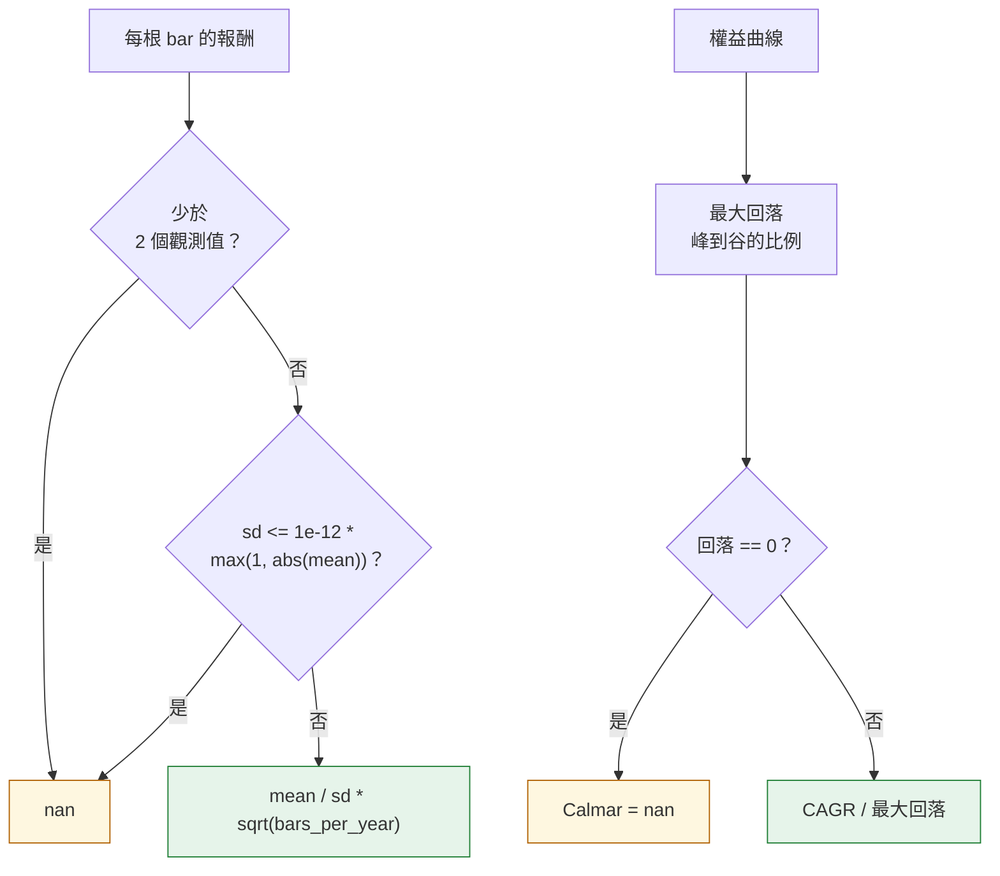

*[English](design.md) ｜ 繁體中文*

# 設計筆記

README 主張的四個決定，以及各自背後的理由。

---

## 1. index 的約定，以及執行這個約定的那一個位移

回測裡每一個對齊 bug，本質上都是對「index `t` 是什麼意思」有不同理解。所以它
被一次講定，其餘程式碼服從它：

> index `t` 的特徵可以讀 `close[0..t]`（含 `t`）。bar `t` 已經收了，它的收盤價
> 是已知的。由這個讀數產生的部位，持有的是 bar `t + 1`。

寫成程式就是 `backtest.run` 裡的兩行：

```python
position = np.zeros(c.size)
position[1:] = target[:-1]
```



兩個後果被直接斷言：

- bar 0 永遠是空手。沒有 bar -1 可以做過任何決定。
- 一個等於「當根自己的報酬」的訊號——這是收盤時真正已知的資訊——在延遲之後
  賺不到東西。在沒有植入訊號的序列上，同一批數字若不延遲就套用，分數是
  `sum(abs(return))`，也就是整條序列。那個差距就是一個未來資料洩漏在紙上
  值多少。

特徵回傳與輸入等長的陣列、暖機期填 `nan`，而不是回傳較短的陣列。在源頭丟掉
row，會讓下游每一個 index 位移，而且每個特徵位移的量還不一樣，這種位移要等到
權益曲線好得不像話才會被看見。`Design.rows` 帶著每個保留 row 的 bar index，
所以回到 bar 空間是單一呼叫點上的一次查表。

---

## 2. 洩漏檢查器為什麼擾動未來而不是讀程式碼

程式碼審查抓得到 `close[t+1]`。它抓不穩在切分前就 fit 的 `StandardScaler`、
置中的滾動視窗、或回填的 `nan`。這三個裡面根本沒有任何往前的 index；資訊是
透過一個「在錯誤範圍上算出來的統計量」進來的。

所以檢查器把特徵當黑箱，直接測那個真正重要的性質：



三個承重的細節：

**擾動是透過 `exp` 的乘法，不是 `1 + z`。** 第一版用 `close * (1 + 0.5 *
randn)`，把一些 bar 壓成負數。所有對數報酬特徵於是回傳 `nan`，檢查器報出的
洩漏其實是「被餵了不可能的價格序列」的產物。一個會被自己的輸入騙到的檢查器，
比沒有檢查器更糟。

**衝擊要大，不要小。** 很小的改動可以躲在浮點進位裡，而比較用的是容忍度很緊的
`np.isclose`。半個對數價格標準差遠在那之外。

**多個切點，包含一個很早的切點。** 檢查器原本只在中點切，四個洩漏抓到三個。
`backfilled_warmup` 乾淨通過，因為它只污染前六十根，而到第 750 根已經沒有東西
可以回填。`default_cuts()` 現在探測 `{20, n/10, n/4, n/2, 3n/4, n-5}`。

比較時連 `nan` 的有無也一起比，因為一個原本產生 `nan` 的位置開始產生數字，
也是變了。

回報的 `first_leak` index 是診斷資訊，而它畫出的區分，在你要動手修的時候有用：

| 第一個動掉的 index | 代表什麼 |
|---|---|
| 切點後退一格 | 位移方向寫反了 |
| 切點後退約一個視窗 | 置中視窗；距離是視窗的一半 |
| **0** | 在整條序列上算出來的統計量 |

---

## 3. purge 與 embargo 是兩個參數，因為它們是兩種洩漏



它們被保持為兩個參數，因為兩者的精確程度不同：

| | 透過什麼洩漏 | 長度 |
|---|---|---|
| purge | 標籤期間——`t` 的標籤是 `t + h` 以前所有 bar 的函數 | **精確**：`h` |
| embargo | 相鄰 bar 之間的序列相關 | **一個選擇**：沒有精確值 |

把兩者併成一個間隔會讓程式更短，也會讓 `embargo=0` 時悄悄連標籤期間一起不
purge——那是一種沒有症狀的洩漏。`tests/test_split.py` 單獨斷言了這個情況。

值得講明的實作細節：間隔被放在訓練集結尾與測試視窗開頭之間，所以
`gap == horizon + embargo` 每一折都可以直接量。測試斷言的是距離，不是被存起來
的參數。一個被記錄下來卻沒被套用的參數，正是這裡要防的 bug。

折次是往前走的，訓練集永遠嚴格在過去，所以 embargo 在這裡只有一邊。
`purged_window()` 處理單一保留集的情況——那裡訓練資料在兩側都有，embargo 套在
測試視窗之後，purge 套在它之前。

---

## 4. 退化的指標為什麼回傳 `nan`



什麼都不持有的策略，權益曲線是平的。最大回落真的是 `0`。Sharpe 無定義，而三個
候選答案錯得不一樣：

| 回傳 | 問題 |
|---|---|
| `0.0` | 會被讀成量測結果。審查者看到的是「一個沒有風險調整後報酬的策略」，而不是「一個沒有報酬的策略」。 |
| 丟例外 | 只要報告裡有一列合法地為平，整份報告就產不出來 |
| `nan` | 會傳播、會印成 `nan`、會強迫讀到的人去看 |

離散度的保護是這裡變有趣的地方。第一版是 `sd == 0.0`。一條斷言「常數報酬序列
沒有 Sharpe」的測試對著它失敗了：500 個相同的 1 bp 報酬，樣本標準差約為
**1e-20**，因為算出來的平均值不會剛好等於輸入值。保護把這個值放了過去，比值
年化後跑出接近 **1e16**。相對下限修掉了它，常數命名為 `ZERO_DISPERSION`，
來由寫在註解裡。

年化在每一個會年化的函式裡都是參數，而用到的 `bars_per_year` 帶在報告裡。
`252` 只出現一次，當作 `BARS_PER_YEAR` 裡的一個值，不會寫死在任何公式裡。同一
條報酬序列用日頻與週頻年化會差 `sqrt(252/52)`，大約 **2.2 倍**，
`test_annualisation_is_a_parameter_not_a_constant` 斷言了這件事。

---

## 測試對應到哪裡

| 設計元素 | 測試 |
|---|---|
| 部位在訊號後一根才持有 | `test_position_is_held_one_bar_after_the_signal` |
| 當根訊號賺不到東西 | `test_a_same_bar_signal_earns_nothing_once_the_lag_is_applied` |
| 每個出貨特徵都撐得過擾動 | `test_every_shipped_feature_is_causal` |
| 四個植入的洩漏全被抓到 | `test_checker_catches_every_leak` |
| 洩漏距離指認出 bug | `test_leak_distance_is_reported_and_matches_the_bug` |
| 間隔等於 purge 加 embargo | `test_the_gap_is_exactly_purge_plus_embargo` |
| embargo 為 0 時仍然 purge | `test_zero_embargo_still_purges_the_label_horizon` |
| 沒有 bar 被訓練過它的模型預測 | `test_no_bar_is_predicted_by_a_model_that_trained_on_it` |
| 成本真的進到權益曲線 | `test_zero_cost_and_real_cost_give_different_sharpe` |
| 全現金給 0 回落與 nan Sharpe | `test_all_cash_has_zero_drawdown_and_no_sharpe` |
| 常數報酬序列沒有 Sharpe | `test_a_constant_non_zero_return_also_has_no_sharpe` |
| 反向訊號得到負的 Sharpe | `test_inverting_a_profitable_signal_inverts_the_sign_of_sharpe` |
| 年化是參數 | `test_annualisation_is_a_parameter_not_a_constant` |
| 過短與全平的基線拒絕回答 | `test_a_short_window_reports_insufficient_data_not_ok`、`test_a_flat_baseline_reports_insufficient_data_not_an_infinite_z` |
| 植入的 regime 變化被找到 | `test_the_volatility_regime_change_is_detected_where_it_happens` |
| 沒植入訊號就找不到訊號 | `test_with_no_signal_planted_the_pipeline_finds_none` |
| 一個洩漏特徵毀掉一切 | `test_a_leaky_feature_set_scores_absurdly_well` |
| 相同種子、相同權益曲線 | `test_two_identical_walk_forward_runs_give_identical_equity` |
